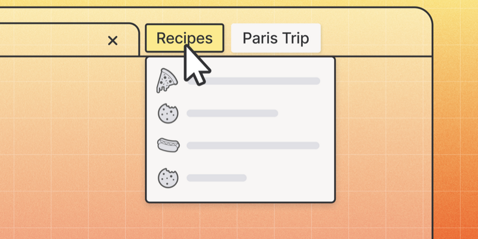
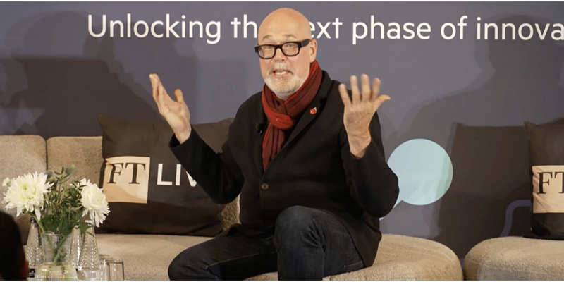
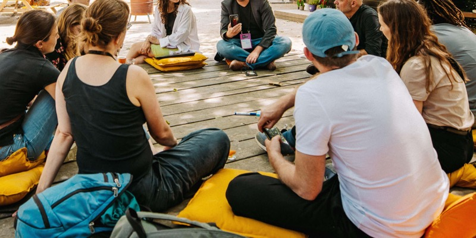
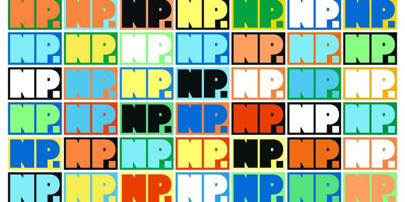

# Writing Alt Text (for Wagtail Editors)

The "alt text" (alternative text) on an image describes images for people who can't see them. Usually this means people who are having the webpage read aloud to them by a device or app.

## When to Use Alt Text

If the image is removed and no information is missing, then the image is decorative and doesn't need alt text. You can leave the field in Wagtail blank.

An image also doesn't need alt text if it only repeats what the text next to it already says.

If you're unsure, the [W3C Alt Text Decision Tree](https://www.w3.org/WAI/tutorials/images/decision-tree/) walks through the common cases.

## Writing Effective Alt Text

- Think about context
- Be concise
- Be specific
- Don't repeat nearby text
- When there are people in it, describe what matters to the page
- End alt text with a period

### Think About Context

Ask yourself why the image is on the page and what someone would miss without it. The same image can need different alt text depending on where it's used. See the [tab group example](#examples) below.

### Be Concise

Usually a few words to one short sentence is enough. 125 characters is a good rough guide.

Don't start with "image of" or "picture of." Screen readers already announce "image" or "graphic" before reading alt text.

❌ `Photo of a red panda sleeping on a tree branch.` 
❌ `A cute red panda sleeping peacefully on a tree branch in the forest.` 
✅ `Red panda sleeping on a tree branch.`

### Be Specific

Describe what's actually in the image, focusing on details relevant to the surrounding content.

❌ `VPN screenshot.` 
✅ `Mozilla VPN dashboard showing connection status.`

### Don't Repeat Nearby Text

If a caption or nearby paragraph already describes the image, don't say the same thing again in the alt text. Leave it blank, or add only what the text leaves out.

### When There Are People In It

- If you know their names, use their names
- Describe the action or mood conveyed
- Don't guess someone's gender, age, race, or other identity
- Don't describe how people look unless it is necessary for context

❌ `Asian woman with her hair in a pony tail.`  
✅ `Person with a laptop bag and Mozilla lanyard.` 
✅ `Contributor at a Mozilla hackathon.`

## Special Cases

### Images Containing Text

If an image contains text that isn't anywhere else on the page, include that text in the alt text.

❌ `Stylized pull quote.` 
✅ `“Brevity is the soul of wit.” — William Shakespeare`

### Charts and Infographics

Give a short summary in the alt text and put the full information in the page text or a table.

❌ `Bar chart.` 
✅ `Bar chart of Firefox downloads by year, details in the table below.`

## Examples

{ width="400" }

❌ `Screenshot of Firefox.` 
✅ `A tab group of recipes.` 
✅ `Tab groups appear next to your open tabs.`

{ width="400" }

❌ `Bald white man in a black jacket and red scarf.` 
✅ `Mark Surman, Mozilla President.`

{ width="400" }

❌ `Nine people sitting on yellow pillows on the floor.` 
✅ `People sitting in a circle on the floor sharing ideas.`

{ width="400" }

❌ `NP. NP. NP. NP. NP. NP. NP. NP. NP.` 
❌ `NP repeated 42 times in different colors.` 
✅ If the magazine's name is nearby - blank alt text.  
✅ `Nothing Personal logo.`

## Additional Resources

- [W3C Alt Text Decision Tree](https://www.w3.org/WAI/tutorials/images/decision-tree/)
- [W3C Images Tutorial](https://www.w3.org/WAI/tutorials/images/)
- [WebAIM Alternative Text](https://webaim.org/techniques/alttext/)
